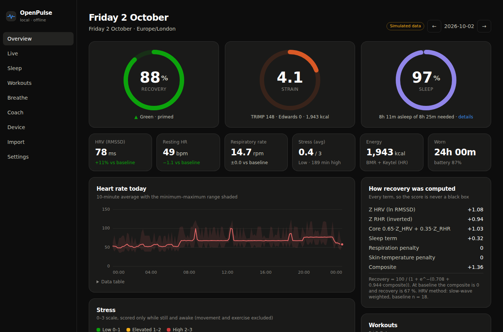

# OpenPulse 5.0

An offline, local-first companion for a WHOOP 5.0 strap you own. OpenPulse talks to the strap directly over Bluetooth Low Energy and stores every raw packet in a local SQLite database. It computes recovery, strain, sleep stages and stress on your own machine using published formulas, and shows them in a dark-mode dashboard.

OpenPulse never contacts WHOOP servers. Nothing leaves your computer unless you explicitly switch the AI coach to a cloud provider.



> The screenshots show **simulated** data from the built-in physiology simulator (`npm run seed:demo`).

---

## Read this first: what is verified and what is not

| Area | Status |
|---|---|
| AA01 frame format: CRC16-Modbus header over bytes 0..5, CRC32 (zlib) payload, length and flags fields | **Verified** by test vectors. `AA0108000001E67123019101363E5C8D` checks out byte for byte (header CRC `0x71E6`, payload CRC `0x8D5C3E36`). |
| `CLIENT_HELLO` frame | **Verified**: the frame builder reproduces it exactly. |
| `0x2A37` heart rate + R-R parsing (`10407c03` gives 64 bpm and 871.09 ms) | **Verified** against the Bluetooth Heart Rate Service spec and the test vector. |
| Raw-first storage, replay, importers, scoring pipeline, dashboard | Tested: 160+ automated tests, plus end-to-end runs with the simulator. |
| Connecting to a **real** WHOOP 5.0 over noble or Web Bluetooth | **Not tested on hardware.** No strap was available while this was built. The transports implement the documented noble and Web Bluetooth APIs and were exercised only against the simulator. |
| Proprietary commands other than hello, and proprietary record layouts (`0x28`, `0x2F` record 18, `0x33`/`0x34` IMU, `0x2B` record 21) | **Community-reported, unverified.** Opcodes and byte offsets come from the MIT-licensed [@dofek/whoop-ble](https://github.com/Asherlc/dofek) reverse engineering (see [NOTICE.md](NOTICE.md)). They are labelled *unverified* in the UI and are never sent automatically. |
| Haptics and alarm opcodes | **Unknown.** Neither the spec nor the community source documents them, so OpenPulse does not guess. You can add them to a protocol map once you discover them (see below). |
| Recovery, strain, sleep stages, stress | **OpenPulse's own estimates**, computed from published sports-science formulas and calibrated on synthetic data. They are not WHOOP's proprietary scores and not medical measurements. |

Service naming: your spec calls `fd4b0001-…` the "Puffin" service. The community source calls `fd4b…` "Maverick/Goose" and lists `11500001-6215-11ee-8c99-0242ac120002` as "Puffin". OpenPulse scans for and handles both, since both use the same AA01 framing.

Using an undocumented protocol on your own device is your call. It may stop working after a firmware update, and it is not endorsed by WHOOP.

---

## Quick start (no strap needed)

Requirements: Node.js 22 or newer, macOS or Linux (Windows works except for the LaunchAgent).

```bash
npm install
npm run seed:demo -- --days 21 --demo-profile   # simulated history, labelled "simulated"
npm run dev                                      # dashboard on http://127.0.0.1:3000
npm run daemon:simulate                          # live stream from the simulated strap (second terminal)
```

Remove the simulated data later with `npm run seed:demo -- --clear`.

## Using your strap

1. **Pair (bond) the strap with the computer** in the OS Bluetooth settings. The daemon checks the bond: if the strap rejects an unencrypted read, the daemon stops with `BOND_REQUIRED` and tells you to pair.
2. **Free the strap.** A BLE peripheral usually accepts a single central, so close the official app or switch off Bluetooth on your phone if the strap isn't found. If the standard Heart Rate service doesn't appear, enabling heart-rate broadcast in the official app may be needed.
3. **Run the daemon.**
   ```bash
   npm run daemon                     # first strap found
   npm run daemon -- --name WHOOP     # filter on the advertised name
   npm run daemon -- --device <id>    # a specific peripheral id (shown on the Device page)
   ```
4. Open **http://127.0.0.1:3000/live**.

**noble prerequisites.** `@abandonware/noble` is an optional native dependency.
- macOS: grant Bluetooth permission to your terminal (and to the `node` binary for background use) under System Settings → Privacy & Security → Bluetooth.
- Linux: install BlueZ and give node raw-socket access: `sudo setcap cap_net_raw+eip $(eval readlink -f $(which node))`.

**Web Bluetooth fallback.** In Chrome or Edge on desktop or Android, the Live and Device pages offer *Connect via Web Bluetooth*. The browser runs the same protocol engine and forwards every raw packet to `/api/ingest`, where it is stored before decoding, exactly like daemon captures. Safari and every browser on iOS lack Web Bluetooth, so iPhone and iPad cannot use this path.

### Handshake (what the daemon does)

1. Connect and discover services. Read the Device Information strings and battery level. An authentication or encryption error means the strap isn't bonded.
2. Subscribe to `0x2A37`, `0x2A19` and the proprietary notify characteristics (`…0003`, `…0004`, `…0005`, `…0007`).
3. Write `CLIENT_HELLO` (`AA0108000001E67123019101363E5C8D`) to `…0002`.
4. Wait up to 3 s for an ack on `…0003` (a command response echoing opcode `0x91` or sequence 1). Without an ack it continues, because `0x2A37` streams regardless.
5. Send any startup commands you configured (Settings → Daemon). By default it sends none.
6. **Raw-first:** every notification is inserted into `raw_packets` (timestamp, characteristic UUID, hex payload, `decoded_status`) **before** it is decoded.

On disconnect the daemon reconnects with exponential backoff (1 s doubling to 60 s, with jitter).

### Protocol map: commands you discover yourself

Create `data/protocol-map.json` and restart the daemon. The commands show up on the Device page, and a command named `haptic` enables strap cues in the breathing pacer:

```json
{ "commands": [{ "name": "haptic", "label": "Haptic buzz", "opcode": "0x??", "args": "01" }] }
```

Frames are built as `AA 01 | len | 00 01 | CRC16 | 23 seq opcode args… | CRC32`. Built-in names (`hello`, …) can't be overridden.

---

## Architecture

```
 strap ──BLE──▶ daemon (Node)                      browser (Chrome/Edge)
               ├ transport: noble | simulator      ├ Web Bluetooth transport
               ├ BleSession (hello, acks)          ├ same BleSession + decoder
               ├ IngestPipeline ── raw_packets ◀───┴ POST /api/ingest (raw)
               │      └ decoder ─▶ hr_rr_samples, motion_samples
               ├ daily processor (every 5 min) ─▶ epochs, sleep, workouts,
               │                                   daily_summaries, user_baseline
               └ WebSocket 127.0.0.1:7781 ──live──▶ dashboard (Next.js, 127.0.0.1:3000)
                                                    └ reads SQLite (WAL) directly
```

| Path | Contents |
|---|---|
| `src/lib/protocol/` | `constants.ts`, `crc.ts`, `bytes.ts`, `packetParser.ts` (0x2A37, battery, AA01 frames, record layouts), `frameAssembler.ts` (fragmentation and resync), `commands.ts`, `decoder.ts` |
| `src/lib/ble/` | transport interface, `nobleTransport.ts`, `webBluetoothTransport.ts`, `simulatorTransport.ts`, `session.ts` |
| `src/lib/daemon/` | `bleDaemon.ts` (connection manager), `wsServer.ts`, `liveStress.ts`, `main.ts` |
| `src/lib/storage/` | Drizzle `schema.ts`, `db.ts`, `settings.ts`, `replay.ts`, CLI |
| `src/lib/importers/` | WHOOP CSV export, Apple Health XML (streaming) |
| `src/lib/physiology/` | `hrv.ts`, `respiration.ts`, `baseline.ts`, `recovery.ts`, `strain.ts`, `sleepClassifier.ts`, `sleepNeed.ts`, `stressMonitor.ts`, `workoutDetector.ts`, `energy.ts`, `epochs.ts` |
| `src/lib/pipeline/` | `ingest.ts` (raw-first), `dailyProcessor.ts` |
| `src/lib/coach/` | context builder, prompts, providers |
| `src/app/` | dashboard pages and API routes |

### Data model (SQLite, `data/openpulse.db`)

`raw_packets`, `hr_rr_samples` (one row per heart-rate report with its R-R list), `motion_samples`, `biometric_epochs` (30 s), `sleep_sessions`, `workouts`, `daily_summaries` (one row per date and source: `openpulse`, `whoop_csv` or `apple_health`), `user_baseline`, `devices`, `settings`, `import_runs`, `coach_messages`. Every derived or imported row records its source. Imported scores are never mixed into OpenPulse's own.

### Replay

Raw bytes are kept, so improved decoders can be applied to all history. When a byte layout is mapped, bump `PARSER_VERSION` in `src/lib/protocol/constants.ts` and run:

```bash
npm run replay           # packets decoded by an older parser (or never decoded)
npm run replay -- --all  # everything
```

Replay rebuilds the derived samples for the replayed range, refreshes each packet's status, and rescores the affected days. The Device page has the same buttons.

Statuses: `decoded`, `partial`, `fragment` (completed by a later notification), `unsynced`, `unmapped` (valid frame, layout unknown), `crc_error`, `malformed`, `ignored`, `error`.

---

## Scoring

All of this runs locally in `src/lib/physiology/`. Each daily summary stores the inputs behind its score, and the dashboard shows the breakdown.

**HRV** (`hrv.ts`). R-R intervals outside 300–2000 ms, or more than 20 % from the median of the local 5-beat window, are rejected. RMSSD = √(1/(N−1) Σ(RRᵢ₊₁−RRᵢ)²) is taken only over accepted, time-adjacent pairs; SDNN, pNN50 and ln RMSSD are reported too (Task Force of the ESC/NASPE, 1996). Overnight HRV comes from rolling 5-minute windows (2.5-minute step), weighted by slow-wave fraction × pairs when at least two windows are mostly deep sleep, and averaged in log space (Plews et al., 2012). R-R values from consecutive `0x2A37` notifications are chained into one continuous beat series, as the Heart Rate Service intends.

**Respiratory rate** (`respiration.ts`). This is respiratory sinus arrhythmia: the dominant 0.1–0.5 Hz frequency of the R-R series, found with a Lomb-Scargle periodogram (Lomb 1976, Scargle 1982), taking the median of 2-minute windows across the night.

**Baselines** (`baseline.ts`). 30-day EWMA (α = 2/31) with exponentially weighted variance (Finch 2009), a cumulative mean during warm-up, and SD shrinkage toward population priors with floors. Day D is always scored against the baseline as of D−1. Imported WHOOP HRV and RHR can seed baselines for days without strap data.

**Recovery** (`recovery.ts`). This estimate combines the following:
- Z_HRV = (ln RMSSD − μ)/σ and Z_RHR = (μ − RHR)/σ.
- core = 0.65·Z_HRV + 0.35·Z_RHR.
- A sleep-performance term, plus penalties for acutely raised respiratory rate and skin temperature.
- Recovery = 100/(1+e^−(a+b·composite)), with a = ln(67/33) so a baseline night scores 67 %, and b = 0.944 (−1.5 → 33 %, +1.5 → 89 %).
- Bands: green 67–100, yellow 34–66, red 0–33.
- The score reads "calibrating" until 4 nights are in the baseline.

**Resting HR** is the lowest 5-minute rolling mean during the main sleep.

**Strain** (`strain.ts`). The steps are:
- %HRR uses Karvonen.
- Banister TRIMP and the Edwards zone load (zones 1–5 at 50/60/70/80/90 % HRR, weights 1–5) are both computed.
- The load L is TRIMP *in excess* of the 30 % HRR light-activity floor (ACSM).
- Strain = min(21, k·ln(1+αL)), with **k = 4.1, α = 0.315**, fitted by `scripts/calibrate-strain.ts` to simulated reference days. On six seeds: rest ≈ 3.5–4.4, a 45-minute moderate workout ≈ 11.3–12.1, a 2.5–3 h endurance session ≈ 19.0–20.0.
- Max HR is your measured value, or Tanaka (208 − 0.7·age).

**Sleep** (`sleepClassifier.ts`, `sleepNeed.ts`).
- Detection: wrist stillness plus heart rate below RHR + 0.65·(waking HR − RHR), capped at RHR + 14. Without motion data an HR-stability test is used instead. The result is smoothed, short gaps are bridged, and periods under 20 minutes are dropped.
- Staging: 30-second epochs are scored on HR level, local HR variability, ln RMSSD, motion and time of night. Deep means low and stable HR with high vagal tone; REM means fluctuating HR with stillness, suppressed early in the night.
- Validation so far: about 91 % agreement on *simulated* nights, which only shows the implementation behaves as designed. It is not polysomnography.
- Sleep need = baseline (7.75 h by default) + 3.5 min per strain point above 8 (capped at 50 min) + the previous three nights' shortfall weighted ½, ¼, ⅛.
- Performance = asleep/need. Consistency is the overlap of the sleep window with the previous four nights.

**Stress** (`stressMonitor.ts`, 0–3). Each minute, the trailing 60 s are scored while the body is still:
- HR component: 1.5 × clamp((HR₆₀ − resting-day HR)/(0.15·HRR)).
- HRV component: 1.5 × clamp((μ_day lnRMSSD − lnRMSSD₆₀)/(1.5σ)).
- Minutes with motion above 0.05 g are excluded. Without motion data, minutes above 40 % HRR are excluded as likely exercise.

**Workouts** are sustained effort at or above 40 % HRR for at least 8 minutes (dips up to 2 minutes allowed). They're labelled by intensity, never by a guessed sport. **Energy**: Keytel et al. (2005) during activity, Mifflin-St Jeor BMR otherwise.

The physiology simulator (`src/lib/simulation/`) generates beat-level R-R with respiratory sinus arrhythmia, a 0.1 Hz component, ectopic beats and motion artefacts. It is used for tests, calibration, the demo and the simulated strap. It never touches real data.

---

## Importing history

On the **Import** page or from the CLI:

```bash
npm run import -- ~/Downloads/my_whoop_data.zip          # WHOOP app data export (ZIP or CSVs)
npm run import -- ~/Downloads/export.zip                 # Apple Health export (streamed; multi-GB is fine)
```

- **WHOOP CSV**: `physiological_cycles.csv`, `sleeps.csv` and `workouts.csv` are matched by header name with aliases, and unknown columns are reported. The values are WHOOP's own and are stored as source `whoop_csv`. The overview shows them alongside, never in place of, OpenPulse scores.
- **Apple Health**: heart rate, resting HR, HRV SDNN (kept separate: SDNN is not RMSSD), respiratory rate, SpO₂, wrist temperature, sleep stages (Watch stages win over overlapping iPhone "in bed" entries) and workouts. Sparse Apple heart rate is never used for scoring.

---

## AI coach

The **Coach** page sends a compact JSON context with each question: today's summary, baselines, 7- and 28-day averages, the last 14 days, the latest sleep, recent workouts and flags such as calibration status or a rapid load increase. The page shows exactly what will be sent. It never includes raw samples, device serials or your name.

- **Ollama (default, local):** `ollama serve` and `ollama pull llama3.1:8b`. Only loopback URLs are accepted.
- **OpenAI / Anthropic (cloud, opt-in):** set a key in Settings (or `OPENAI_API_KEY` / `ANTHROPIC_API_KEY`), choose the provider and tick *allow sending my biometric summaries*. Until then no request is made.

The coach is not a medical service. The system prompt tells it to ground every claim in your numbers, never invent data, and suggest a professional for sustained abnormal readings.

---

## Running in the background (macOS)

```bash
./scripts/install-launch-agent.sh     # builds, installs com.openpulse.daemon + com.openpulse.dashboard, starts both
./scripts/uninstall-launch-agent.sh   # removes the agents (data is kept)
```

The agents start at login, restart if they exit, and log to `~/Library/Logs/OpenPulse/`. Run `npm run daemon` once from Terminal first so macOS can show the Bluetooth permission prompt.

To run both in the foreground on any OS: `./scripts/start.sh` (add `--simulate` for the simulator).

---

## Privacy and network

- The dashboard binds to **127.0.0.1**. `src/proxy.ts` rejects requests whose `Host` isn't loopback (DNS rebinding) and cross-site writes to the API (CSRF).
- The live WebSocket binds to **127.0.0.1** and only accepts the configured dashboard origins.
- Next.js telemetry is disabled in every script (`NEXT_TELEMETRY_DISABLED=1`).
- The only outbound connections are the strap (BLE) and, if you enable it, the coach provider you chose.
- API keys are stored in the local database. Environment variables take precedence.

## Storage size

A day of 1 Hz heart rate with R-R adds roughly 10–20 MB, including raw packets. Standard-service raw packets can be pruned while keeping the decoded samples and all proprietary raw packets:

```bash
npx tsx src/lib/storage/cli.ts prune --sig-raw-older-than 180
```

## Commands

| Command | Purpose |
|---|---|
| `npm run dev` / `npm run build` / `npm start` | dashboard (development / build both / production) |
| `npm run daemon` / `npm run daemon:simulate` | BLE daemon (real strap / simulator); `--db`, `--port`, `--device`, `--name`, `--no-process` |
| `npm run seed:demo` | simulated history (`--days`, `--seed`, `--demo-profile`, `--clear`) |
| `npm run import -- <file>` | WHOOP or Apple Health import (`--type`, `--tz`) |
| `npm run replay` / `npm run recompute` | re-decode raw packets / rescore days (`--from`, `--to`, `--days`) |
| `npm run db:generate` / `npm run db:migrate` | Drizzle migrations |
| `npx tsx scripts/calibrate-strain.ts` | re-fit the strain curve |
| `npm test` / `npm run typecheck` / `npm run lint` | quality gates |

Environment variables are listed in [.env.example](.env.example).

## Development

```bash
npm test           # vitest: protocol vectors, framing, session, storage, replay, importers, physiology, pipeline, daemon, coach, guards
npm run typecheck
npm run lint
```

Tests use in-memory SQLite and the simulator, so no Bluetooth hardware is needed.
